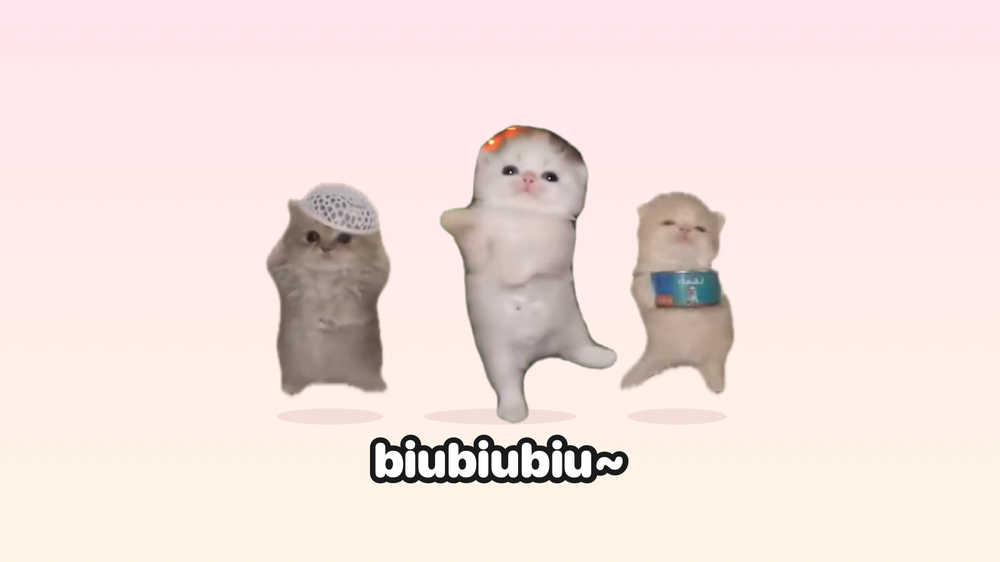

# biubiu 小猫桌宠

把小红书上很火的 biubiu 小猫做成了 Mac 桌宠：它会站在你的桌面上跳舞、放 biubiu 音乐、召唤两个同伴一起蹦迪，还能像台球一样满屏乱撞



## 能做什么

小猫头顶有一排按钮，每个按钮对应一个动作：

| 按钮 | 作用 |
|---|---|
| 跳舞 | 开始或停止跳舞，关掉时音乐和同伴也一起停 |
| 音乐 | 放 biubiu 音乐，小猫会跟着节拍跳 |
| 同伴 | 召唤两只同伴，三只猫一起跳 |
| 一起撞 | 三只猫保持队形，像一颗台球在整个屏幕上砰砰乱撞 |
| 分开撞 | 三只猫各自乱飞，还会互相撞开 |
| 竖屏 | 只在屏幕最右边 9:16 的竖条里活动，方便录竖屏视频 |
| 散步 | 闲着的时候自己在屏幕底部走来走去 |

其他细节：

- 放音乐和乱撞的时候，小猫脚下会蹦出 biubiubiu~ 字幕
- 拖动小猫可以换位置，会记住上次的位置
- 猫身体以外的透明区域不挡鼠标，点小猫也不会抢走你正在用的 app 的焦点
- 右键小猫可以调大小、开关字幕、打开录屏背景（一键遮住桌面上的窗口和图标，只留壁纸，或者换成绿幕方便后期抠图）、退出

## 下载安装

1. 到本仓库右侧的 **Releases** 下载 `biubiu-cat-mac.zip`
2. 解压后把「biubiu小猫」拖进「应用程序」文件夹
3. 第一次打开会被系统拦下（这个 app 没有付费做苹果签名），这样放行：
   - 先双击打开一次，弹窗里点「完成」
   - 打开「系统设置 → 隐私与安全性」，拉到最下面，点「仍要打开」
4. 打开后小猫会出现在屏幕右下角，没有 Dock 图标，退出请右键小猫

系统要求：macOS 13 及以上，Apple 芯片和 Intel 芯片的 Mac 都可以用

## 自己编译

需要先装 Xcode 或 Xcode 命令行工具（终端运行 `xcode-select --install`），然后在项目目录里运行：

```bash
./build.sh
```

打包好的 app 在 `build/biubiu小猫.app`，下载用的压缩包在 `build/biubiu-cat-mac.zip`

## 换成自己的素材

`assets/` 里是已经抠好的素材，编译时直接用，想换成别的猫可以自己准备两段视频：

- `source.mp4`：一只猫的绿幕跳舞视频（用来生成主角和音乐）
- `source2.mp4`：多只猫一起跳舞的视频（用 macOS 自带的主体识别抠出左右两只当同伴）

然后运行 `./make_assets.sh` 重新生成素材，注意 `tools/export.swift` 和 `tools/companions.swift` 里的帧数、裁剪范围是按原视频写死的，换视频后要跟着改

## 项目结构

```
app/main.swift            桌宠本体（Swift + AppKit，单文件）
assets/                   抠好的逐帧透明素材、点击判定遮罩、音乐
tools/export.swift        绿幕抠图 + 导出音乐
tools/companions.swift    用 Vision 主体识别抠出两只同伴
tools/edges.swift.inc     两个抠图工具共用的收边处理
tools/icon.swift          生成 app 图标
tools/preview.swift       生成本页顶部的预览图
build.sh                  编译打包
make_assets.sh            从原视频重新生成素材
```

## 素材来源与版权

- 小猫形象、舞蹈画面和背景音乐来自小红书上的网络热门视频（绿幕版来自 @羊莓豆豆，三猫合跳版来自 @總之你像一隻垂耳兔），版权归原作者所有
- 本项目仅供学习交流，不得用于商业用途，如果你是原作者并希望删除相关素材，请提 Issue 联系
- 代码部分以 MIT 协议开源，见 [LICENSE](LICENSE)，素材不在开源协议范围内

## 制作过程

整个桌宠是用 [Claude Code](https://claude.com/claude-code) vibe coding 做出来的：从绿幕抠图、系统主体识别抠同伴，到桌宠的动画、台球物理和各种交互，都是通过对话一步步完成的
